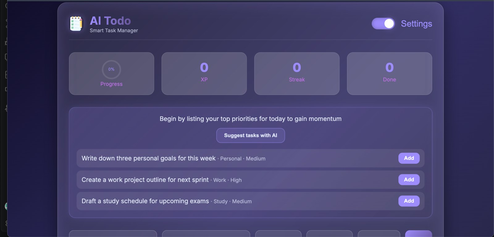
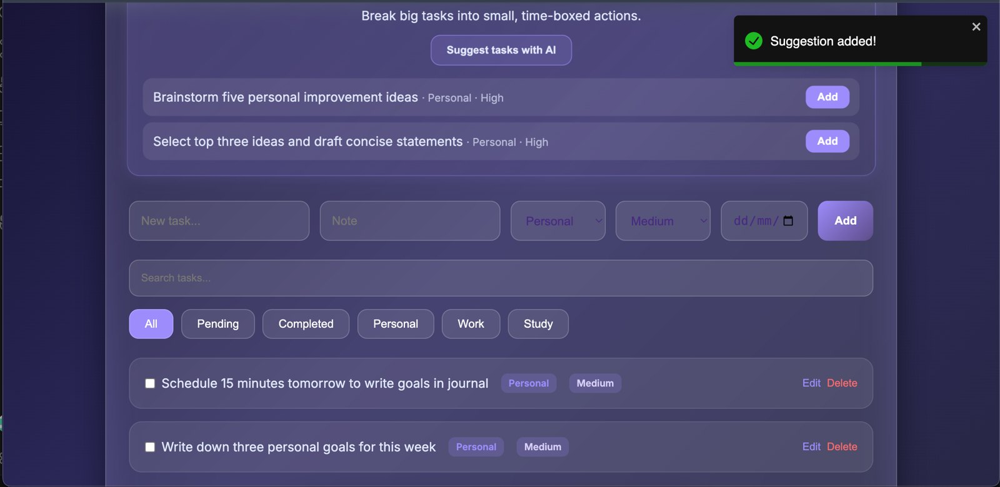

# 🌟 AI Todo – Smart Task Manager


A glassmorphic task manager with **real AI suggestions**, gamified progress and drag-and-drop planning.

🔗 **Live demo:** [YOUR-VERCEL-LINK](https://ai-todo-app-peach.vercel.app/mode)

---

## ✨ Overview

AI Todo helps you organise, prioritise and finish your daily tasks. In **AI Mode**, a Groq-powered serverless function reads your current task list and suggests a planning tip and three concrete next steps, each addable in one click. **Demo Mode** shows built-in sample suggestions with no network calls.

Every completed task earns XP and a confetti celebration, with streaks to keep you coming back. Dark/light themes, drag-and-drop reordering and local storage make it a polished, everyday tool.

---

## 🖼️ Preview

https://github.com/user-attachments/assets/47844cf8-8159-417c-8d6c-21dd03b822e6

<table>
  <tr>
    <td align="center" width="50%">
      <br>
      <sub><b>AI Mode</b> – a planning tip and three suggested next steps</sub>
    </td>
    <td align="center" width="50%">
      <br>
      <sub><b>One-click add</b> – suggestions go straight into your list</sub>
    </td>
  </tr>
  <tr>
    <td align="center" width="50%">
      <br>
      <sub><b>Task list</b> – categories, priorities and progress stats</sub>
    </td>
    <td align="center" width="50%">
      <br>
      <sub><b>Glassmorphic design</b> – dark and light themes</sub>
    </td>
  </tr>
</table>

---

## 🧭 Table of Contents

- [Features](#-features)
- [Demo Mode vs AI Mode](#-demo-mode-vs-ai-mode)
- [Tech Stack](#-tech-stack)
- [How to Run Locally](#-how-to-run-locally)

---

## ⚡ Features

- 🤖 **AI suggestions:** a planning tip and 3 next-step tasks generated from your current list, each addable in one click
- 🔥 **Streaks and XP** to gamify productivity
- 🎉 **Confetti celebration** when you complete a task
- 🗂 **Priority, category and due date** for every task
- 🖱 **Drag-and-drop** reordering with React DnD
- 🌗 **Dark and light themes**
- 📱 **Fully responsive** on all devices
- 💾 **LocalStorage** so your tasks are saved between visits

---

## 🧠 Demo Mode vs AI Mode

| | Demo Mode | AI Mode |
|---|---|---|
| Suggestions | Built-in samples | Generated by a Groq-hosted model from your tasks |
| Network calls | None | One request to the app's serverless function |
| API key needed | No | No, the key stays on the server |

**How the AI part is built** (`api/suggest.js`):
- The browser sends the task list to a Vercel serverless function, which calls the Groq API. The key lives only in Vercel's environment variables, never in the browser.
- The model is told to reply with JSON only, and the server validates every field (category and priority must be known values) before anything reaches the app.
- Task text is treated as data, not instructions, and is trimmed to a safe length.
- A per-visitor rate limit and a 15-second timeout protect the free API quota.
- Clear error messages when the AI is busy or unavailable, so the app never hangs.

---

## 🧰 Tech Stack

| Area | Technology |
|---|---|
| Frontend | React 18, Vite, JSX, pure CSS (glassmorphism and animations) |
| AI | Groq API via a Vercel serverless function |
| Interaction | React DnD, Canvas Confetti, React Circular Progressbar |
| Storage | Browser LocalStorage |
| Hosting | Vercel |

---

## 💻 How to Run Locally

```bash
git clone https://github.com/aqsak-dev99/Ai-to-do-app.git
cd Ai-to-do-app
npm install
npm run dev
```

Open **http://localhost:5173**. Demo Mode works straight away.

To use **AI Mode** locally, run the app with the Vercel CLI so the serverless function runs too, and add your own Groq key:

```bash
vercel env add GROQ_API_KEY
vercel dev
```

---

## 👩‍💻 Author

Made by **Aqsa Khan**: [GitHub](https://github.com/aqsak-dev99) · [LinkedIn](https://www.linkedin.com/in/aqsa-khan-dev/) · [Portfolio](https://aqsa-portfoliio.vercel.app)

⭐ If you like this project, give it a star on GitHub!
